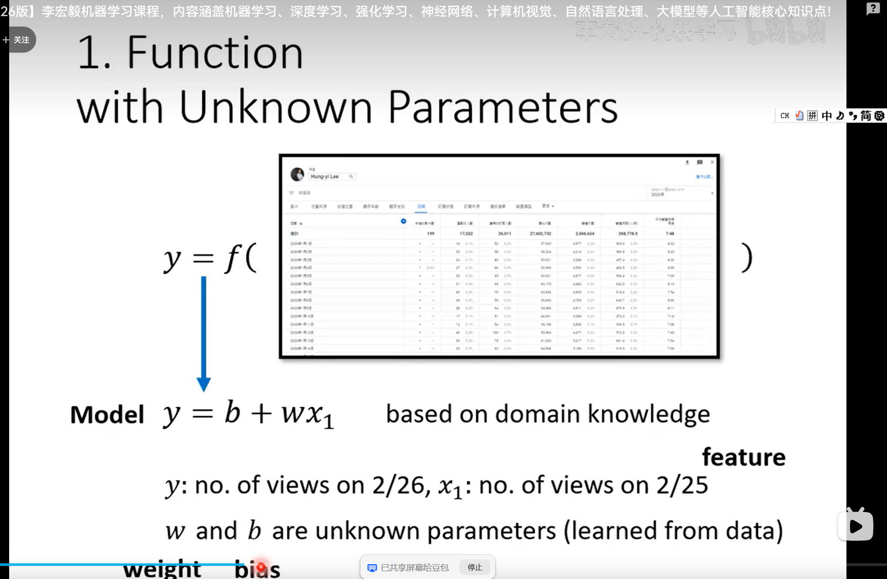
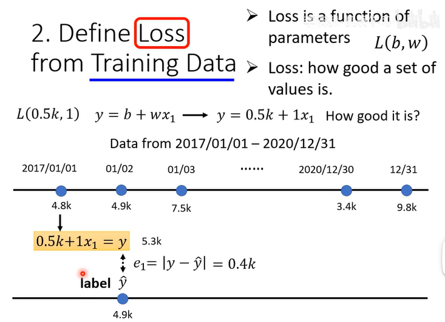
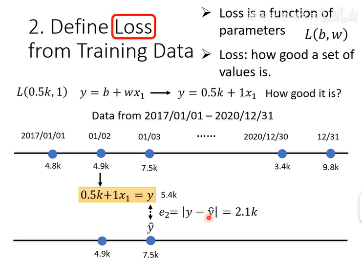
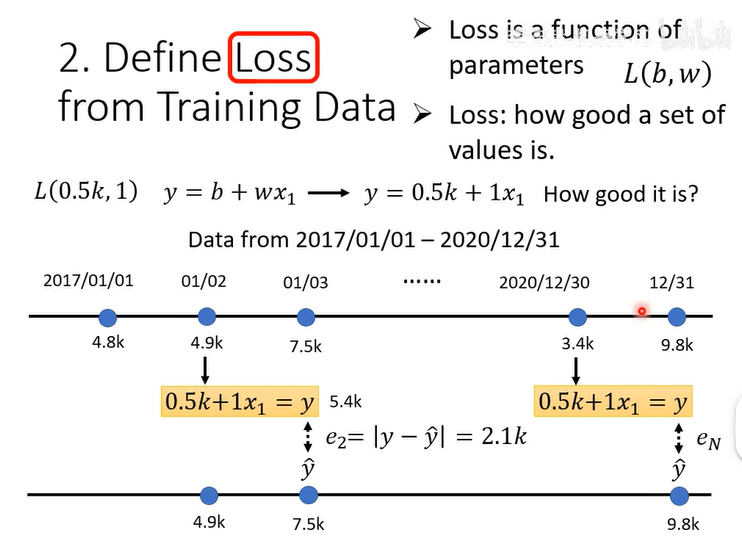

# 李宏毅机器学习 Lecture 01
## 核心思想
机器学习 = 让机器自动找一个函数 $f$

## 机器学习三大任务
- 回归（Regression）：
  1. 输出连续数值（scalar）的任务
  2. 回归 ⊂ 预测任务
- 补充：预测
  1. 分类 ⊂ 预测任务
  2. 但“预测”不一定是回归（也可能是分类）
  
- 分类（Classification）：输出类别
  - 分类输出的类别，**不能当作数值做算术/距离运算**
    - nominal：因为**没有顺序、没有间距**，所以不可量化
    - ordinal：**有顺序但间距不可量化**，所以也不可量化
  
- 结构化学习（Structured Learning）：create something with structure，输出序列/图，比如翻译、画图

## 连续数值（continuous value）vs 离散类别（discrete category）
- 连续数值（continuous）：取值可在区间内无限细分，有大小、距离含义，可以做算术运算。回归任务预测这类值。
- 离散（discrete）：取值分开可数，不存在中间过渡值；**离散≠无关联**，离散分为两类：
  1. 无序类别（nominal）：类别之间无大小、无顺序，仅为不同标签，不能比较大小、不能算术。例：颜色、猫狗。
  2. 有序类别（ordinal）：类别有先后顺序，但类别间距不可量化，不能直接做算术。例：学历、电影评分。

> 区分重点：
> “离散/连续”看取值能不能无限细分；“nominal/ordinal”看类别之间有没有顺序。

- 回归（regression）：输出连续数值（continuous value）
- 分类（classification）：输出离散类别（discrete category），大多是 nominal；ordinal 可使用有序回归（ordinal regression），介于回归与普通分类之间
- 易混补充：离散数值（discrete numeric）比如"人数"（1,2,3…）是离散的，但它是数值、有大小、能做算术。所以"离散"和"类别"不是同义词——离散数值既不是连续值，也不完全是类别。分类任务通常处理的是 categorical（类别型），而不是所有 discrete 值。
- 分类输出的是 categorical label，不能做数值运算；nominal 是"无间距"，ordinal 是"有顺序但间距不可量化"。你的直觉没错，只是 nominal 那里别用"间距"这个词。

## 机器学习步骤
机器学习的核心流程可以拆成下面几步：
1. 定义要找的函数模型
  
2. 收集训练数据
3. 定义损失函数（loss function）
  
  
  
4. 寻找使损失最小的参数（训练（training））
5. 在测试集（test set）上验证模型效果

## 深度学习
深度学习是机器学习的一个分支，用多层神经网络作为函数集合。
